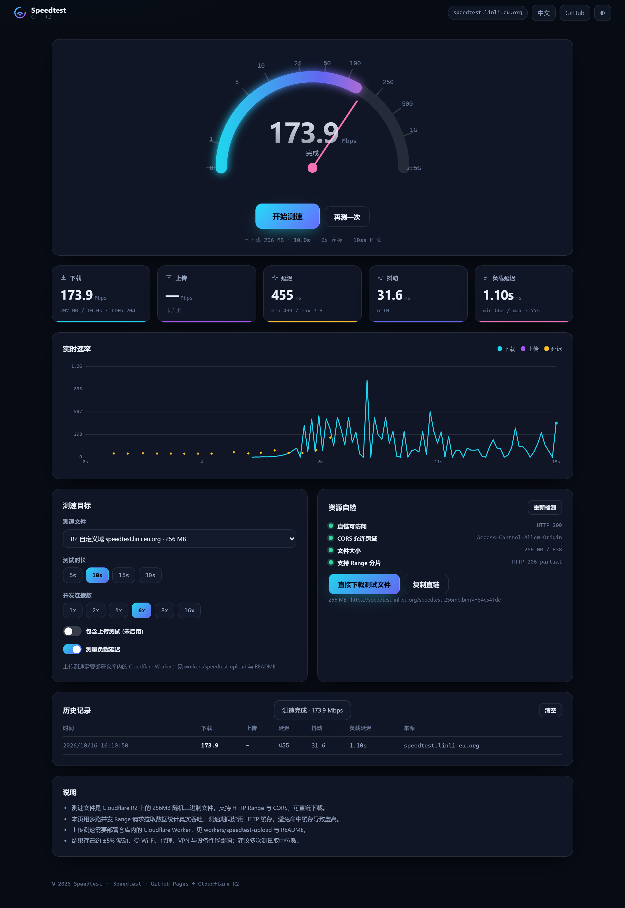

# Speedtest · GitHub Pages + Cloudflare R2

A dependency-free, build-free network speedtest web app.

* **Site** — static, hosted on **GitHub Pages** (no bundler, no runtime npm deps)
* **Test payload** — a **256 MB** incompressible binary on **Cloudflare R2**, direct-downloadable, CORS + HTTP Range enabled
* **Measured** — download, upload, idle latency, jitter, packet loss, and **loaded latency** (latency while the link is saturated)



---

## Why not put the 256 MB file on GitHub Pages?

Because GitHub does not allow it. Verified against GitHub's own docs and live endpoints:

| Host | Single-file limit | `Access-Control-Allow-Origin` | HTTP `Range` |
|---|---|---|---|
| GitHub Pages | repo push caps at **100 MB/file** (1 GB site) | Yes — `*` | Yes |
| `raw.githubusercontent.com` | 100 MB | Yes — `*` | Yes |
| GitHub Releases (2 GB/file) | 2 GB | **No** | Yes |
| **Cloudflare R2** | none | **fully configurable** | Yes |

A browser speedtest must read the response body to count bytes, so **CORS is mandatory**. GitHub Releases assets sit on Azure Blob behind Fastly and return no CORS header, which makes them unusable from `fetch()`. Cloudflare R2 is the right home for the payload, and its egress is free.

---

## Architecture

```
  Browser
    |  GET https://USER.github.io/REPO/          <- site  (GitHub Pages)
    |  GET https://speed.example.com/big.bin     <- payload (Cloudflare R2)
    |        Range: bytes=0-4194303                6x parallel range requests
    |        cache: no-store                       HTTP cache disabled
    v
  result: Mbps / ms / jitter / loaded latency
```

---

## Quick start (Windows, 3 commands)

```powershell
# Token needs: Contents=write, Pages=write, Administration=write, Workflows=write
$env:GITHUB_TOKEN = "ghp_xxxxxxxx"

# 1) Generate a 256 MB incompressible file
node scripts/make-testfile.mjs --size 256

# 2) Upload it to Cloudflare R2 + write config.json (needs: npx wrangler login)
node scripts/r2-setup.mjs

# 3) Publish the site to GitHub Pages
node scripts/publish.mjs --repo YOUR-NAME/speedtest
```

Or all three at once:

```powershell
./scripts/setup.ps1 -Repo "YOUR-NAME/speedtest"
```

macOS / Linux:

```bash
export GITHUB_TOKEN=ghp_xxxxxxxx
node scripts/make-testfile.mjs --size 256
node scripts/r2-setup.mjs --domain speed.example.com --zone-id ZONE_ID
node scripts/publish.mjs --repo YOUR-NAME/speedtest
```

---

## Repository layout

```
index.html                     single-page UI
404.html                       GitHub Pages 404
config.json                    <- the only file you normally edit
.nojekyll                      disables Jekyll on Pages
assets/app.js                  speedtest engine + UI
assets/style.css               theme
assets/favicon.svg
cloudflare/r2-cors.json        R2 bucket CORS policy
workers/speedtest-upload/      optional Cloudflare Worker for upload tests
scripts/make-testfile.mjs      generate the >200MB payload
scripts/r2-setup.mjs           1-click R2: bucket, upload, CORS, public URL, config.json
scripts/publish.mjs            git + GitHub API: create repo, push, enable Pages
scripts/serve.mjs              local dev server (Range + CORS + 256MB stream)
scripts/setup.ps1              runs all three steps
tests/e2e.mjs                  Playwright end-to-end verification
.github/workflows/pages.yml    GitHub Actions Pages deployment
```

---

## config.json

`scripts/r2-setup.mjs` fills this in for you. Every key is optional and deep-merged over the built-in defaults.

```jsonc
{
  "siteName": "Speedtest",
  "repoUrl": "https://github.com/USER/speedtest",
  "download": {
    "files": [{
      "label": "Cloudflare R2 · 256 MB",
      "url": "https://speed.example.com/speedtest-256mb.bin",   // must send CORS + support Range
      "sizeBytes": 268435456
    }],
    "durationSec": 10,        // 5 / 10 / 15 / 30 (selectable in the UI)
    "connections": 6,         // parallel range streams
    "chunkBytes": 4194304     // 4 MiB per range request
  },
  "upload": {
    "enabled": false,         // set true after deploying the Worker
    "url": "https://speedtest-upload.SUB.workers.dev/upload",
    "token": "",              // optional, matches the Worker's TOKEN var
    "durationSec": 8,
    "connections": 3,
    "chunkBytes": 4194304
  },
  "latency": {
    "samples": 10,
    "loadedSamples": 8,
    "intervalMs": 450,
    "probeUrl": "https://speed.example.com/ping.txt"   // optional 1KB probe; avoids ranged pings
  },
  "historyLimit": 20
}
```

Add more entries to `download.files` to expose more mirrors — they appear in the dropdown.

---

## Cloudflare R2 setup

### Automatic

```bash
npx wrangler login                 # or set CLOUDFLARE_API_TOKEN
node scripts/r2-setup.mjs --bucket speedtest-files --file public/speedtest-256mb.bin
```

Creates the bucket, uploads `speedtest-256mb.bin` and `ping.txt`, applies `cloudflare/r2-cors.json`, enables public access, and writes the resulting URLs back into `config.json`.

Use a custom domain (recommended — no rate limit):

```bash
node scripts/r2-setup.mjs --domain speed.example.com --zone-id 0123456789abcdef
```

### Manual (dashboard)

1. **R2 → Create bucket** `speedtest-files`
2. Upload `speedtest-256mb.bin` and `ping.txt`
3. **Settings → CORS policy → Add**, paste the contents of `cloudflare/r2-cors.json`
4. **Settings → Public access**: bind a custom domain, or enable the `r2.dev` URL
5. Put the resulting base URL into `config.json`

> `r2.dev` is rate limited by Cloudflare and meant for development only. For a public speedtest, bind a custom domain.

### Cached 404s (important)

Cloudflare caches responses for R2 custom domains. If you request `https://speed.example.com/big.bin` **before** the object exists, that 404 is cached at the edge and keeps being served after the upload (`cf-cache-status: HIT`, growing `Age`). A `HEAD` returns 200 while a `GET` still returns the stale 404, which is confusing.

Two fixes:

1. **Version the URL** (what this repo does) — `r2-setup.mjs` appends `?v=<sha256-prefix>` to the URL in `config.json`, so a fresh key is used on every re-upload and the stale entry is never touched again. R2 ignores query strings when looking up the object key.
2. **Purge the cache** — Cloudflare dashboard -> Caching -> Configuration -> Purge Cache -> Custom Purge, enter the URLs. Requires a token/role with *Cache Purge* permission; an R2-only token gets `401` from `POST /zones/{id}/purge_cache`.

### CORS policy explained

```jsonc
{
  "rules": [{
    "allowed": {
      "origins": ["*"],                       // or ["https://USER.github.io"] to lock it down
      "methods": ["GET", "HEAD"],
      "headers": ["Range", "Content-Type"]     // Range is required for chunked downloads
    },
    "exposeHeaders": ["Content-Length", "Content-Range", "Accept-Ranges", "ETag"],
    "maxAgeSeconds": 86400
  }]
}
```

`Content-Length` is CORS-safelisted, but `Content-Range` / `Accept-Ranges` are not — without `exposeHeaders` the in-page **resource check** panel cannot confirm range support.

---

## GitHub Pages deployment

### Automatic

```bash
node scripts/publish.mjs --repo YOUR-NAME/speedtest
node scripts/publish.mjs --repo YOUR-NAME/speedtest --private
node scripts/publish.mjs --repo YOUR-NAME/speedtest --no-wait
```

Initialises git, commits, creates the repository through the REST API, pushes, enables Pages with `build_type: workflow`, dispatches `.github/workflows/pages.yml`, and prints the site URL.

### Manual

```bash
git init -b main
git add -A
git commit -m "deploy: speedtest site"
git remote add origin https://github.com/YOUR-NAME/speedtest.git
git push -u origin main
```

Then **Settings → Pages → Source: GitHub Actions**. The shipped workflow deploys on every push to `main`.

Site URL: `https://YOUR-NAME.github.io/speedtest/`

---

## Cloudflare 优选 IP（国内访问的关键）

你的 R2 自定义域**本来就在 Cloudflare CDN 上**（有 `cf-cache-status: HIT` 就是证据）。国内访问慢/断，通常不是「没走 CDN」，而是**免费版分配给你的那两个共享 IP 被限速或阻断**了。

Cloudflare 是 anycast：**任意一个边缘 IP 都能服务你的域名**（SNI/Host 匹配即可）。实测本机同一份文件、同一个桶：

| 边缘 IP | 吞吐 |
|---|---|
| `104.21.84.16`（域名 DNS 当前解析） | 79 KB/s |
| `172.66.0.1` | 189 KB/s |
| `104.24.0.1` | **209.7 Mbps** |
| `172.64.0.1` | 115.5 Mbps |

差了两个数量级。用仓库自带的扫描器随时重新测：

```bash
node scripts/cf-ip-scan.mjs --host speedtest.linli.eu.org --big /speedtest-256mb.bin --bytes 8388608
```

### 用上优选 IP 的三种办法

**1. 本地 hosts / 路由器 DNS（只对自己生效，最快）**

```
104.24.0.1 speedtest.linli.eu.org
```

**2. Worker 接管 + 灰云 A 记录（对所有访客生效）**

R2 自定义域由 Cloudflare 托管那条 DNS 记录，不能手改，所以要换架构：

1. 解绑 R2 自定义域
2. 部署一个带 R2 binding 的 Worker，路由 `speedtest.linli.eu.org/*`，直接返回对象（自己控制 Range / CORS / 缓存头）
3. DNS 加 **A 记录，灰云（DNS only）**，指向扫描出来的优选 IP
4. 访客连的是优选 IP，边缘仍由 Cloudflare 出响应

> 第 3 步「手动 A 记录指向 Cloudflare IP」是在利用 anycast 特性，属于灰色用法，Cloudflare 的 ToS 并不鼓励，自行权衡。

**3. 换掉 Cloudflare**

如果面向大量国内用户，免费版 Cloudflare 的国内可达性本来就时好时坏；方案 2 也只是把问题缓解，不是根治。

## Multiple mirrors and network blocking

`config.json` accepts any number of entries in `download.files`; the UI turns them into a dropdown. On load the page **HEAD-probes every mirror in parallel and auto-selects the fastest reachable one**, so a blocked or throttled entry is skipped instead of breaking the test.

This matters in mainland China: Cloudflare's free-plan proxied records sit on shared anycast ranges (`104.21.x`, `172.67.x`) that are frequently SNI-filtered or rate-limited, while `pub-*.r2.dev` and other Cloudflare ranges stay reachable. Symptom: `TCP/TLS timeout` or `schannel: failed to receive handshake` for the custom domain, while `curl https://speed.cloudflare.com/__down?bytes=25000000` is perfectly fast.

Diagnosis recipe:

```bash
curl -o NUL -w '%{http_code} %{speed_download} B/s\n' --max-time 15 -H 'Range: bytes=0-1048575' https://YOUR-DOMAIN/big.bin
curl -o NUL -w '%{http_code} %{speed_download} B/s\n' --max-time 15 https://speed.cloudflare.com/__down?bytes=25000000
```

If the first fails and the second succeeds, it is the hostname/route, not R2. Options: keep the `r2.dev` mirror as fallback, move the custom domain to a different Cloudflare zone, or put the payload behind a different CDN.

## Upload tests (optional)

```bash
cd workers/speedtest-upload
npx wrangler deploy
```

Then set the Worker URL in `config.json` and flip `upload.enabled` to `true`. The UI enables the *Include upload test* switch automatically. Set `TOKEN` in `wrangler.toml` and `upload.token` in `config.json` to require a bearer token.

The Worker simply drains the request body and returns the byte count, so it costs almost nothing and never stores your data.

---

## Local development and verification

```bash
node scripts/serve.mjs --port 8788            # Range + CORS + streamed 256MB
node scripts/serve.mjs --file public/speedtest-256mb.bin
```

Open `http://127.0.0.1:8788/`. The server mimics an R2 public bucket exactly (206 responses, `Content-Range`, CORS, `Access-Control-Expose-Headers`).

End-to-end test — drives the real UI in headless Edge/Chrome, runs a full download + upload test, asserts the numbers, the button state machine, chart samples and history, then writes screenshots:

```bash
npm install
npm test                 # -> tests/output/01-idle.png, 02-result.png, 03-second-run.png
E2E_CHANNEL=chrome npm test
```

Latest local run:

```
download    = 2671 Mbps   (2.5 GB / 8.0s)
upload      = 117.4 Mbps  (70 MB / 5.0s)
ping        = 2.9 ms
jitter      = 4.0 ms
loaded      = 57.8 ms
range check = HTTP 206, 1024 bytes, bytes 0-1023/268435456
[e2e] PASSED
```

---

## How the measurement works

* **Download** — each connection owns a disjoint byte band of the file and walks it with 4 MiB `Range` requests, reading the response stream and counting `byteLength`. Bytes are discarded immediately, so memory stays flat. Throughput is `bytes * 8 / elapsed`.
* **Caching** — every request uses `cache: 'no-store'`, so the browser HTTP cache never inflates a result. The CDN edge cache may still serve ranges, which is what a real download experiences.
* **Overrun control** — when the duration expires, in-flight reads are aborted, so the run stops within milliseconds.
* **Latency** — one warm-up request (DNS/TCP/TLS) then N `Range: bytes=0-0` requests; the median is ping and the mean absolute difference between consecutive samples is jitter.
* **Loaded latency** — a 1-byte probe every 450 ms *while* the download saturates the link. This is what actually matters for video calls and gaming.
* **Upload** — random 4 MiB blobs POSTed in parallel to the Worker; bytes are counted on completion.
* **Gauge** — logarithmic scale, so 1 Mbps and 1000 Mbps are both readable.

---

## FAQ

**The in-page check says CORS blocked.** Add your Pages origin (or `*`) to the R2 CORS policy and make sure `Range` is in `allowed.headers`.

**Download looks capped at ~100 Mbps.** Usually a single-stream TCP limitation. Raise the connection count to 8 or 16.

**Results are lower than speedtest.net.** Expected — that measures your ISP edge, this measures the path to Cloudflare R2. VPNs, Wi-Fi, proxies and CPU all matter. Run three times and take the median.

**Can I use a smaller file?** Yes — `node scripts/make-testfile.mjs --size 100`. But GitHub Pages still cannot hold it if it exceeds 100 MB, and under 200 MB a gigabit-class measurement becomes less reliable.

**Bandwidth costs?** R2 egress is free, and GitHub Pages has a 100 GB/month soft limit for the (tiny) static site.

---

## License

MIT — see [LICENSE](LICENSE).